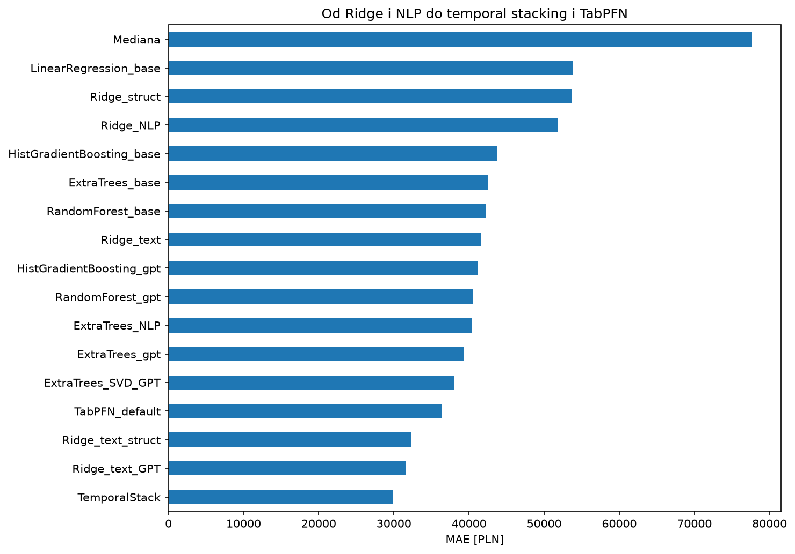

# PricePred — ceny nieruchomości i informacja z tekstu

Projekt sprawdza, ile informacji o cenie ofertowej mieszkania daje tekst ogłoszenia: od prostych cech NLP i TF-IDF, przez cechy GPT, po SVD i stacking modeli.

## Uruchomienie

- Umieść plik źródłowy w `data/real_estate_ads.csv` — katalog `data/` jest ignorowany przez Git. Do eksperymentów GPT potrzebny jest również `llm_features_new.csv`.
- `uv sync`, następnie uruchom `projekt2.ipynb` od początku w katalogu projektu.
- `uv sync --extra tabpfn` instaluje opcjonalny bonus. Dostęp do wag TabPFN wymaga akceptacji licencji przez użytkownika.
- `uv run python -m unittest discover -s tests` sprawdza przygotowanie danych i brak mieszania podziałów.
- Dane dostępowe trzymaj wyłącznie w lokalnym `.env` (wzór: [`.env.example`](.env.example)); tokenów nie wpisuj do notebooków. Dla TabPFN obsługiwane są `TABPFN_TOKEN` i alternatywnie `PRIOR_LABS_API_KEY`.
- Notebook API ma domyślnie `RUN_COMPARE=False` i `RUN_FULL=False`; odtwarzanie modeli ceny korzysta z gotowego cache i nie wywołuje API.

## Pliki

- `projekt2.ipynb` — podział, EDA, porównanie prostych i złożonych modeli, stacking, SHAP i LIME.
- `OpenAI_API_real_estate_ads_new.ipynb` — aktualna ekstrakcja 13 cech GPT, cache `_new`, wspólny podział, lokalna obsługa klucza i log tokenów/czasu.
- `src/pricepred/workflow.py` — wspólny podział, parsowanie parametrów, czyszczenie tekstu i dołączenie GPT.
- `llm_features_new.csv` — 5954 oferty z 13 cechami GPT; `real_estate_with_llm_features_new.csv` — połączone dane.
- `results/` — metryki, predykcje, walidacja, audyty i wykresy.
- `docs/raport.md` — raport z wynikami i ograniczeniami.
- `docs/prezentacja.pptx` — prezentacja wyników.
- Starsze pliki bez `_new` pozostają archiwum; nie mieszaj ich schematu z aktualną ekstrakcją.

## Zrobione

- [x] Jeden podział czasowy w obu aktualnych notebookach: 4758 trening / 1196 test, od 24.05.2020.
- [x] Fit imputacji, kategorii, skalowania, TF-IDF i SVD wyłącznie na treningu każdego okna.
- [x] EDA przed modelami; audyt braków, kategorii GPT, podejrzanych powierzchni i powtarzających się opisów.
- [x] Czyszczenie HTML, encji i kwot z walutą; parsowanie `params` bez pól ceny.
- [x] Włączenie 13 cech GPT i porównanie zespołów z nimi oraz bez nich na identycznych ofertach.
- [x] Prosty Ridge + cechy NLP, potem Extra Trees na tych samych cechach.
- [x] Ridge TF-IDF, Ridge tekst/struktura/GPT i TF-IDF + SVD + Extra Trees.
- [x] Random Forest, Extra Trees, HistGradientBoosting; wybór konfiguracji na trzech oknach walidacji czasowej.
- [x] Wielomodalny temporal stacking z predykcjami OOF bez uczenia gałęzi na przewidywanych etykietach.
- [x] SHAP i LIME dla mocniejszego Extra Trees; kontrola addytywności SHAP i stabilności LIME.
- [x] Poprawki aktualnego API: poprawne nazwy cache, próbka 10 treningowych ofert, brak zależności od Colab i brakującego modułu metryk, pełna ekstrakcja wyłączona, kontrola schematu/fingerprintu cache.
- [x] Raport i prezentacja wyników eksploracyjnych.
- [x] Lokalny TabPFN 10.0.0 bez strojenia: MAE 36,4 tys. PLN, RMSE 64,3 tys. PLN; zapisane predykcje i kontrola ich zgodności z danymi.

## Do zrobienia / potwierdzenia

- [ ] Dokończenie niezależnej oceny 20 przykładów treningowych (asystent przejrzał 5) w `results/llm_review_train.csv`; automatyczne kontrole nie są oceną poprawności faktów.
- [ ] Potwierdzenie rzeczywistej powierzchni oferty 267 000 m² i tożsamości nieruchomości o podobnych opisach.
- [ ] Nowy, niezależny test czasowy; obecny test był już analizowany, więc wyniki są eksploracyjne.
- [ ] Kontrola cen bez waluty / zapisanych słownie i pełnej historycznej proweniencji cache GPT.
- [ ] Wiarygodniejsze wyjaśnienia lokalne: LIME ma nadal niskie lokalne R²; nie przedstawiamy go jako naprawionego.
- [ ] Opcjonalne porównanie Sentence-BERT/BERT i BERTopic; nie były uruchamiane.

## Wyniki na wspólnym teście

Wszystkie poniższe modele oceniono na tych samych **1196 ofertach**. MAE i RMSE są w PLN; niższe wartości oznaczają mniejszy błąd. Wyższe R² jest lepsze.

| Model | MAE [PLN] | RMSE [PLN] | R² |
|---|---:|---:|---:|
| Temporal stacking | 29 881 | 68 397 | 0.767 |
| Ridge — TF-IDF + struktura + GPT | 31 646 | 63 162 | 0.801 |
| Ridge — TF-IDF + struktura | 32 260 | 65 147 | 0.788 |
| TabPFN 10.0.0 — bez strojenia | 36 410 | 64 274 | 0.794 |
| Extra Trees — SVD + struktura + GPT | 37 993 | 74 495 | 0.723 |
| Extra Trees — struktura + GPT | 39 276 | 74 045 | 0.727 |
| Extra Trees — struktura + proste NLP | 40 376 | 81 490 | 0.669 |
| Ridge — TF-IDF | 41 566 | 86 228 | 0.629 |
| Extra Trees — struktura | 42 534 | 82 914 | 0.657 |
| Ridge — struktura + proste NLP | 51 881 | 86 775 | 0.625 |
| Ridge — struktura | 53 665 | 87 770 | 0.616 |
| Mediana treningowa | 77 662 | 149 649 | -0.116 |

- **Najniższe MAE:** temporal stacking, około 29,9 tys. PLN.
- **Najniższe RMSE spośród uruchomionych modeli:** Ridge łączący TF-IDF, strukturę i GPT, około 63,2 tys. PLN. Bardziej złożony model nie wygrywa według każdej miary.
- Dodanie GPT zmniejszyło MAE o około **3,8%** dla Random Forest, **7,7%** dla Extra Trees i **5,9%** dla HistGradientBoosting względem odpowiedników bez GPT.
- TabPFN wykonano lokalnie z domyślnymi ustawieniami, bez przeszukiwania parametrów. Domyślnie notebook odczytuje zapisany wynik przy zgodnych hashach danych i kodu przygotowania; `RUN_TABPFN=True` uruchamia ponowne obliczenia.

Pełne wyniki 17 wariantów: [model_comparison.csv](results/model_comparison.csv). Porównanie korzyści z GPT: [llm_benefit.csv](results/llm_benefit.csv).

## Jak unikamy wycieku danych

- Oba aktualne notebooki korzystają z `shared_split` i tego samego manifestu ID: [train_test_split.csv](results/train_test_split.csv).
- Konfiguracje wybieramy na trzech kolejnych oknach czasowych **wewnątrz treningu**. Wszystkie uczone przekształcenia są dopasowywane od nowa w każdym oknie.
- Po wyborze konfiguracji wykonujemy refit na całym treningu; test przechodzi wyłącznie przez `transform` i `predict`.
- Meta-model stackingu otrzymuje predykcje OOF: każdą z nich tworzy gałąź uczona tylko na wcześniejszych ofertach. Gałęzie stackingu mają z góry ustalone parametry.
- `price_per_m` i pola ceny z `params` nie są cechami. Maskowanie kwot w tekstach nie gwarantuje jednak usunięcia cen zapisanych bez waluty lub słownie.

**Ograniczenie oceny:** obecny test był już wielokrotnie analizowany. Wyniki są eksploracyjne; nie dobieraj na ich podstawie kolejnych parametrów. Końcowe potwierdzenie jakości wymaga nowego, nieoglądanego zbioru czasowego.

## Wyjaśnienia i audyty

- SHAP i LIME wyjaśniają **Extra Trees z GPT**, wybrany według walidacji — nie końcowy stacking. Dane referencyjne pochodzą z treningu.
- SHAP wskazuje przede wszystkim powierzchnię, parking i liczbę pokoi. To wkłady do predykcji modelu, a nie efekty przyczynowe.
- Lokalny R² LIME dla trzech ziaren wynosi około **0,10–0,12**. Jego przybliżenie jest słabe; wag nie traktujemy jako wiarygodnego wyjaśnienia.
- [Przegląd ekstrakcji GPT](results/llm_review_train.csv): asystent przejrzał 5 z 20 ofert; pozostałe wymagają oceny. Zauważono m.in. pomylenie widoku z nasłonecznieniem oraz stanu mieszkania z czasem remontu.
- [Audyt powierzchni](results/area_audit_train.csv) zachowuje oryginalną wartość 267 000 m². Model traktuje ją jako brak; prawidłowej wartości nie ustalono.

## Raport i prezentacja

- [Raport z eksperymentów](docs/raport.md)
- [Prezentacja wyników](docs/prezentacja.pptx)
